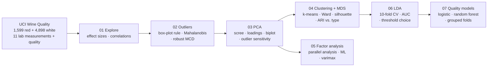

# Wine Quality: Multivariate Analysis in R

**Outlier detection, PCA, clustering, MDS, factor analysis and discriminant analysis on 6,497 Portuguese *vinho verde* wines: what does the chemistry say about wine type and expert quality ratings?**

[](https://github.com/casildata/wine-quality-multivariate-analysis/actions/workflows/pipeline.yml)


-success)


> **Origin:** adapted from a graduate team project in **Multivariate Analysis** at Texas Tech University (2021). This repository is a solo rebuild: the analysis code was rewritten from scratch in base R, and every number below is regenerated by `Rscript run_all.R`.

---

## TL;DR

| Question | Answer |
|---|---|
| Can unsupervised methods tell red from white? | **Yes.** k-means with k = 2 matches wine type for **98.6%** of wines (adjusted Rand index 0.94) without ever seeing the label; PC1 alone correlates 0.83 with type |
| How many dimensions does the chemistry really have? | 3 principal components (eigenvalue > 1) explain **64%** of the variance; PC1 = red vs. white, PC2 = sugar/density vs. alcohol |
| Are there outliers? | Robust (MCD) Mahalanobis distance flags **761** wines vs. **197** for the classical distance: *masking*. The robust count ranges from 524 to 761 across four variants (log scale, duplicates removed, rescaled cutoff), always 3.2–3.9× the classical one |
| Can chemistry predict a "good" (7+) white wine? | Partly. LDA reaches AUC **0.78**, barely above alcohol alone (0.75). A random forest reaches **0.85**, but only with folds that keep duplicate wines together: random folds report 0.93, because 32% of white wines have an identical twin in another fold |
| Bug found in the original analysis | The original outlier rule used the *lower* chi-square tail, flagging the 32 most **typical** wines as outliers |


---

## Approach



| Step | Script | Highlights |
|---|---|---|
| 1 | [`01_explore.R`](scripts/01_explore.R) | Standardized mean differences rank what separates red from white (total SO₂, volatile acidity, chlorides); correlation heatmap |
| 2 | [`02_outliers.R`](scripts/02_outliers.R) | Three outlier rules compared per wine type, chi-square Q-Q plot of classical vs. robust distances, robustness table (log scale, duplicates removed, rescaled cutoff) |
| 3 | [`03_pca.R`](scripts/03_pca.R) | PCA on standardized data, interpretable components, loadings stable (\|r\| ≈ 0.99) when outliers or repeated rows are removed |
| 4 | [`04_clustering_mds.R`](scripts/04_clustering_mds.R) | k chosen by silhouette, agreement with true type by adjusted Rand index, white-wine "style" clusters vs. quality, MDS ≡ PCA check |
| 5 | [`05_factor_analysis.R`](scripts/05_factor_analysis.R) | Parallel analysis for the number of factors, Heywood-case detection, varimax loadings |
| 6 | [`06_discriminant_analysis.R`](scripts/06_discriminant_analysis.R) | Cross-validated LDA, sensitivity/specificity/AUC, why a 0.5 threshold misleads on imbalanced classes |
| 7 | [`07_quality_models.R`](scripts/07_quality_models.R) | Duplicate audit, LDA vs. logistic regression vs. random forest under random and grouped folds, sensitivity at 90% specificity |

Every table and figure: [`docs/results.md`](docs/results.md).

## Results

### What separates red from white

| Variable | Red median | White median | Std. mean difference (red − white) |
|---|---|---|---|
| total sulfur dioxide | 38 | 134 | −2.28 |
| volatile acidity | 0.52 | 0.26 | +2.00 |
| chlorides | 0.079 | 0.043 | +1.39 |
| sulphates | 0.62 | 0.47 | +1.30 |
| alcohol | 10.2 | 10.4 | −0.08 |

Alcohol barely differs between types, yet it is the single measurement most correlated with quality (r = 0.44).

### Outliers: why the robust estimate matters


If the data were multivariate normal, the points would follow the dashed line. The classical distances (blue) bend away late because the outliers inflate the covariance they are measured against. The robust MCD distances (red) expose the tail. Flagged wines are kept, and the PCA is re-run without them to check they don't drive the components.

### Clustering finds wine styles, not quality grades

Within white wine, three chemistry clusters differ in mean quality (5.61 → 6.15, ANOVA p < 0.0001), and the share of 7+ wines ranges from 9% to 34%. The pattern is real but modest: the clusters explain 6.7% of the variation in quality (η² = 0.067). Clusters are styles (sweet and dense, high acidity, high pH) rather than quality grades.


### Predicting "good" white wine (10-fold CV)

| Threshold | Accuracy | Sensitivity | Specificity | Balanced accuracy | AUC |
|---|---|---|---|---|---|
| 0.5 | 80.1% | 31.3% | 93.6% | 62.5% | 0.784 |
| 0.22 (base rate) | 71.9% | 73.6% | 71.4% | 72.5% | 0.784 |
| Baseline: alcohol only, 0.22 | 71.8% | 70.5% | 72.2% | 71.3% | 0.752 |

80% accuracy at 0.5 sounds good until you notice that "always predict not good" scores 78%. Choosing the threshold is a business decision, not a default. And the other ten measurements add only 0.03 of AUC over alcohol alone.

### Better models, and a leak in the usual evaluation

937 white wines repeat an earlier lab profile exactly (none with a conflicting score), so random folds put copies of the same wine on both sides of the split. Grouped folds keep every copy in one fold:

| Model | AUC, random folds | AUC, grouped folds | Good wines caught at 90% specificity |
|---|---|---|---|
| Alcohol only (LDA) | 0.752 | 0.751 | 37.9% |
| LDA | 0.784 | 0.782 | 42.5% |
| Logistic regression | 0.790 | 0.788 | 42.6% |
| Random forest (500 trees) | **0.925** | **0.847** | 52.2% |

The linear models can't memorize a profile, so the leak barely touches them; the forest loses 0.078 of AUC once it can't recognize copies. The LDA results above stand, and the honest forest number is 0.85.

## Limitations & lessons learned

- **Check which tail you're testing.** The original outlier code flagged `pchisq(d²) < 0.001`, which picks the wines *closest* to the centre. Plotting the flagged points would have caught it immediately.
- **Classical estimates hide the outliers you're looking for.** Robust covariance (MCD) found almost 4× as many unusual wines. Skewness matters too: logging five right-skewed variables cuts both counts by about a third.
- **Near-collinear variables break maximum-likelihood factor analysis.** Density is 91% explained by sugar and alcohol, which pushes uniquenesses to zero (a Heywood case). `factanal` doesn't warn; you have to check.
- **Accuracy is the wrong headline on imbalanced classes.** Report sensitivity, specificity and AUC, and choose the threshold on purpose.
- **Duplicates leak through random folds.** 1,177 rows (18%) repeat an earlier row. They hardly matter for PCA or linear models, but they inflated the random forest's AUC by 0.08. Folds are grouped by lab profile for every model comparison.
- **The duplicates are kept, as in the original study.** Whether they are repeat bottles or data-entry copies can't be told from the data; sections 2, 3 and 7 of the report show how much each result moves without them.

## Getting started

### Requirements

- R 4.1 or later (tested on 4.6.1; unit tests also run on 4.1 in CI) with `ggplot2`, `patchwork`, `randomForest` and `digest` (`MASS` and `cluster` ship with R). `digest` is only needed for the data check on R older than 4.5. [`renv.lock`](renv.lock) pins the exact versions.
- Data ships with the repo in `data/raw/`: the exact UCI files, checked against their SHA-256 checksums before every run.

### Install

```r
install.packages(c("ggplot2", "patchwork", "randomForest", "digest"))
# or, for the pinned versions:
renv::restore()
```

Nothing is installed automatically: if a package from [`r-packages.txt`](r-packages.txt) is missing, the scripts stop and print the command.

### Run

```bash
Rscript run_all.R          # full pipeline
Rscript tests/testthat.R   # unit tests (needs testthat)
```

CI runs the tests and the pipeline on every push with the pinned versions, fails if `docs/results.md` changes, and runs the tests again on R 4.1.

### Output

About 1.5 minutes. Writes `docs/results.md` and the figures in `docs/figures/`; outlier flags go to `outputs/outlier_flags.csv` (git-ignored).

## Repository structure

```
wine-quality-multivariate-analysis/
├── run_all.R                     # checks the data, runs scripts 01-07, writes docs/results.md
├── r-packages.txt                # R packages used by the scripts
├── renv.lock                     # pinned package versions
├── .github/workflows/            # CI: tests, pipeline, drift check, secret scan
├── R/
│   ├── check_packages.R          # stops with install instructions if a package is missing
│   ├── check_data.R              # stops if a raw CSV doesn't match data/raw/SHA256SUMS
│   ├── helpers.R                 # data loader, duplicate keys, CV folds, adjusted Rand index, AUC
│   └── report.R                  # markdown report + figure helpers
├── scripts/01_…07_*.R
├── tests/testthat/               # unit tests for the helpers and the data check
├── data/
│   ├── raw/                      # UCI Wine Quality CSVs (CC BY 4.0) + SHA256SUMS
│   └── README.md                 # source, licence, citation, data dictionary
└── docs/
    ├── results.md                # generated
    └── figures/                  # generated
```

## Skills demonstrated

`Multivariate statistics (Mahalanobis distance, robust covariance, PCA, classical MDS, k-means and hierarchical clustering, exploratory factor analysis, linear discriminant analysis)` · `random forests` · `model validation (k-fold and grouped cross-validation, leakage audit, silhouette, adjusted Rand index, AUC)` · `reproducible R pipelines` · `clear statistical communication`

## Roadmap

- Confirmatory factor analysis with `lavaan` on red wine to test whether the white-wine factor structure carries over.
- Treat quality as ordinal (proportional-odds model) instead of a 7+ cutoff.
- Render the report with R Markdown/Quarto for a single HTML deliverable.

## Data & citations

Data: [UCI Machine Learning Repository: Wine Quality](https://archive.ics.uci.edu/dataset/186/wine+quality), licensed CC BY 4.0. See [`data/README.md`](data/README.md).

> P. Cortez, A. Cerdeira, F. Almeida, T. Matos and J. Reis. *Modeling wine preferences by data mining from physicochemical properties.* Decision Support Systems, 47(4):547–553, 2009.

## Author

Javier Casildo

## License

Code: MIT. See [LICENSE](LICENSE). Data: CC BY 4.0 (original authors).
