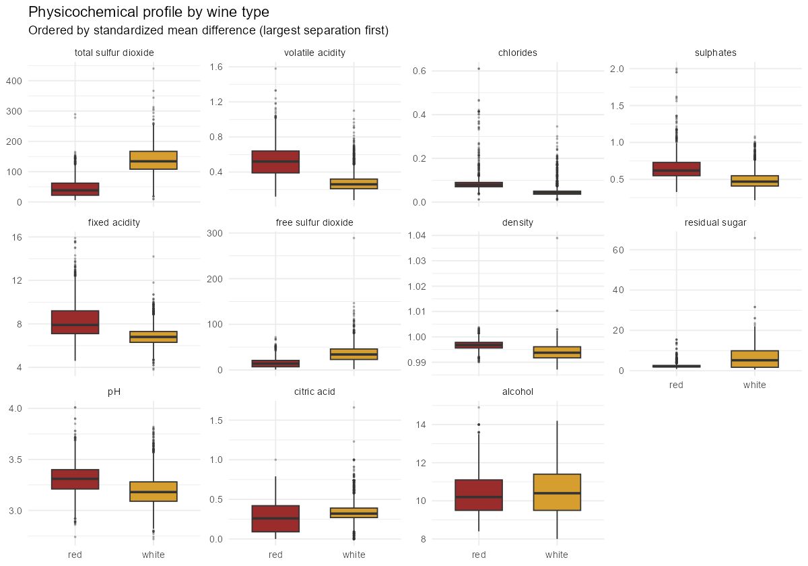
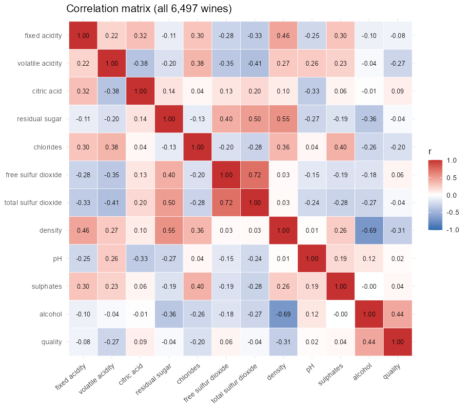
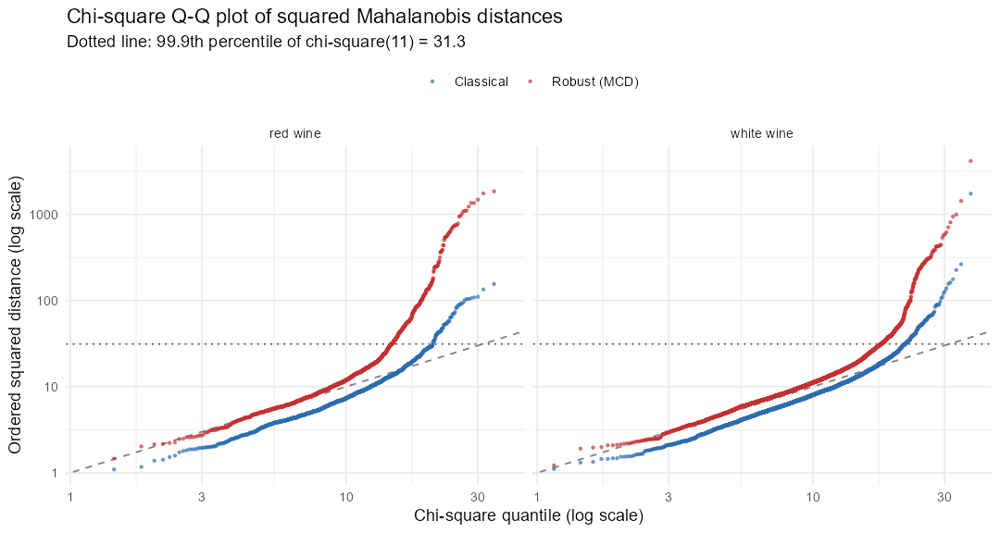
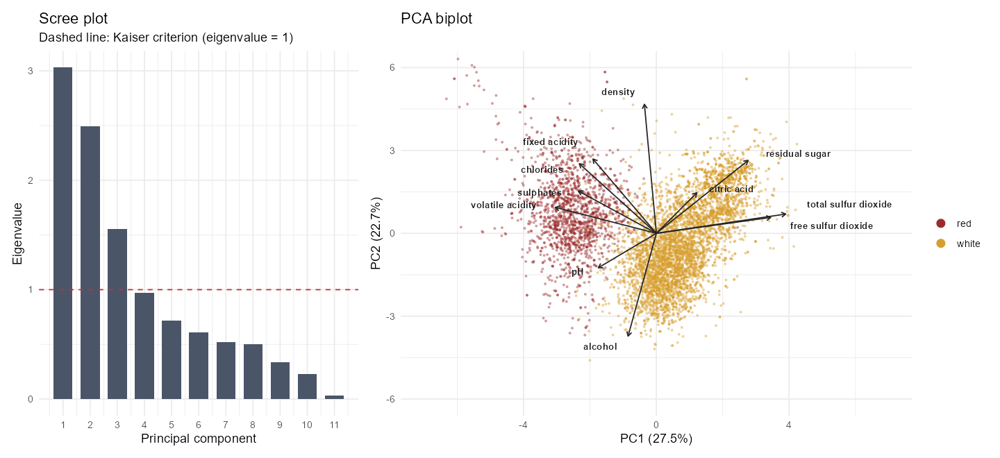
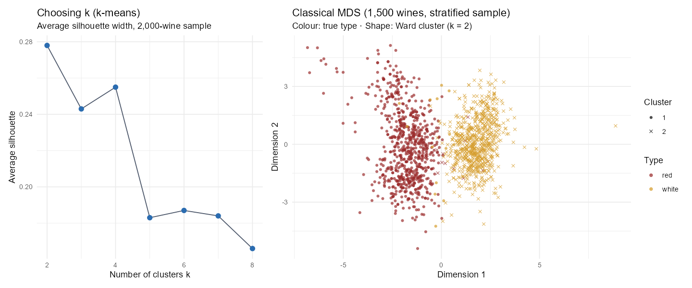
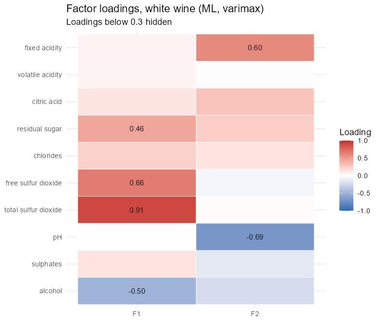
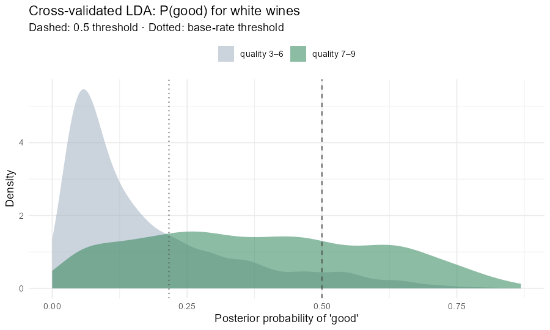

# Results

Generated by `Rscript run_all.R` from the UCI Wine Quality data (Cortez et al., 2009).

## 1. Exploration

6,497 wines (1,599 red, 4,898 white), 11 physicochemical measurements and a sensory quality score (median of at least three expert ratings). 1,177 rows are exact duplicates; they are kept, as in the original study, because identical lab profiles can come from different wines.

**Quality scores by type** (most wines score 5–6; the scale is used narrowly):

| type | 3 | 4 | 5 | 6 | 7 | 8 | 9 |
|---|---|---|---|---|---|---|---|
| red | 10 | 53 | 681 | 638 | 199 | 18 | 0 |
| white | 20 | 163 | 1,457 | 2,198 | 880 | 175 | 5 |

**What separates red from white?** Standardized mean difference (red − white, in pooled SDs):

| variable | red_median | white_median | std_mean_diff |
|---|---|---|---|
| total sulfur dioxide | 38 | 134 | -2.28 |
| volatile acidity | 0.52 | 0.26 | 2.00 |
| chlorides | 0.079 | 0.043 | 1.39 |
| sulphates | 0.62 | 0.47 | 1.30 |
| fixed acidity | 7.9 | 6.8 | 1.29 |
| free sulfur dioxide | 14 | 34 | -1.24 |
| density | 0.9968 | 0.9937 | 0.99 |
| residual sugar | 2.2 | 5.2 | -0.86 |
| pH | 3.31 | 3.18 | 0.81 |
| citric acid | 0.26 | 0.32 | -0.44 |
| alcohol | 10.2 | 10.4 | -0.08 |

**Strongest correlations between measurements:**

| pair | r |
|---|---|
| free sulfur dioxide × total sulfur dioxide | 0.72 |
| density × alcohol | -0.69 |
| residual sugar × density | 0.55 |
| residual sugar × total sulfur dioxide | 0.50 |
| fixed acidity × density | 0.46 |

Alcohol is the measurement most correlated with quality (r = 0.44); density is the most negative (r = -0.31), largely because alcohol lowers density.

## 2. Multivariate outliers

Each type is screened separately (their centres differ). A wine is flagged when its squared Mahalanobis distance exceeds the 99.9th percentile of chi-square(11) = 31.3.

| type | wines | boxplot_rule | classical_mahalanobis | robust_mcd | both_mahalanobis | original_lower_tail_rule |
|---|---|---|---|---|---|---|
| red | 1,599 | 120 | 60 | 322 | 60 | 9 |
| white | 4,898 | 159 | 137 | 439 | 137 | 23 |

| comparison | share_of_robust_flags_also_caught |
|---|---|
| Box-plot rule vs. robust MCD | 32.6% |
| Classical vs. robust MCD | 25.9% |

The classical distance uses a mean and covariance that the outliers themselves inflate (*masking*), so it flags far fewer wines than the robust MCD estimate. The heavy upper tail in the Q-Q plot shows that the 11-variable normal model doesn't hold (several variables, such as chlorides and sulphates, are strongly right-skewed). Flagged wines are kept; section 3 re-runs the PCA without the classical outliers to check that they don't drive the components.

**Masking or skewness?** With the five most skewed variables on a log scale (residual sugar, chlorides, free sulfur dioxide, sulphates, volatile acidity), the classical distance flags 136 wines and the robust one 524. Masking holds either way (the robust estimate flags several times more), but heavy tails, not only masking, inflate both counts.

**Bug in the original analysis, fixed:** the original script flagged wines with `pchisq(d2) < 0.001`, the *lower* tail. That selects the most typical wines (here 32 wines with d² between 1.09 and 1.83), not the most unusual ones.

## 3. Principal component analysis

Standardized variables (they're on very different scales). 3 components have eigenvalue > 1; the first two explain 50.2% and the first 3 explain 64.4% of the variance.

| component | eigenvalue | variance | cumulative |
|---|---|---|---|
| PC1 | 3.03 | 27.5% | 27.5% |
| PC2 | 2.49 | 22.7% | 50.2% |
| PC3 | 1.56 | 14.1% | 64.4% |
| PC4 | 0.97 | 8.8% | 73.2% |
| PC5 | 0.72 | 6.5% | 79.7% |
| PC6 | 0.61 | 5.5% | 85.3% |

Loadings (signs fixed so PC1 is positive for white wine):

| variable | PC1 | PC2 | PC3 |
|---|---|---|---|
| fixed acidity | -0.24 | 0.34 | 0.43 |
| volatile acidity | -0.38 | 0.12 | -0.31 |
| citric acid | 0.15 | 0.18 | 0.59 |
| residual sugar | 0.35 | 0.33 | -0.16 |
| chlorides | -0.29 | 0.32 | -0.02 |
| free sulfur dioxide | 0.43 | 0.07 | -0.13 |
| total sulfur dioxide | 0.49 | 0.09 | -0.11 |
| density | -0.04 | 0.58 | -0.18 |
| pH | -0.22 | -0.16 | -0.46 |
| sulphates | -0.29 | 0.19 | 0.07 |
| alcohol | -0.11 | -0.47 | 0.26 |

- **PC1** (27.5%): high total sulfur dioxide, free sulfur dioxide, residual sugar; low volatile acidity, sulphates, chlorides. PC1 is the **red vs. white axis**: its scores correlate 0.83 with wine type, although type was never given to the PCA.
- **PC2** (22.7%): high density, fixed acidity, residual sugar; low alcohol. PC2 is a **body/ripeness axis** (sugar and density against alcohol).
- **PC3** (14.1%): high citric acid, fixed acidity, alcohol; low pH, volatile acidity.

**Robustness:** re-running without the 197 classical outliers leaves the loadings almost unchanged (|r| between old and new loadings: PC1 0.993, PC2 0.989, PC3 0.994).

## 4. Clustering and multidimensional scaling

**k-means on all wines** (standardized, 25 random starts):

| k | within_ss | avg_silhouette | ari_vs_type |
|---|---|---|---|
| 2 | 56,135 | 0.278 | 0.940 |
| 3 | 45,570 | 0.243 | 0.452 |
| 4 | 40,715 | 0.255 | 0.396 |
| 5 | 38,063 | 0.183 | 0.256 |
| 6 | 35,827 | 0.187 | 0.248 |
| 7 | 34,020 | 0.184 | 0.201 |
| 8 | 32,720 | 0.166 | 0.160 |

The average silhouette is highest at k = 2. With k = 2 the clusters match wine type for 98.6% of wines (adjusted Rand index 0.94): **the chemistry separates red and white without being told which is which.** Ward hierarchical clustering on a stratified sample agrees (ARI at k = 2: 0.93).

**Within white wine**, three chemistry clusters differ in quality (ANOVA p < 0.0001, η² = 0.067):

| cluster | wines | mean_quality | share_quality_7plus | profile |
|---|---|---|---|---|
| 2 | 1,628 | 6.15 | 34.0% | high pH, low fixed acidity |
| 3 | 1,468 | 5.90 | 23.0% | high fixed acidity, low pH |
| 1 | 1,802 | 5.61 | 9.3% | high density, high residual sugar |

The differences are real but modest: the clusters explain 6.7% of the variation in quality. Clustering finds *styles* of wine, not quality grades. Section 6 tests prediction directly.

**MDS check:** classical MDS on Euclidean distances of standardized data is mathematically equivalent to PCA; the first MDS dimension correlates 1.000 with PC1 scores of the same wines.

## 5. Exploratory factor analysis (white wine)

Density is excluded: residual sugar and alcohol alone explain 90.7% of its variance, and keeping it forces uniquenesses to zero. Parallel analysis on the remaining 10 variables retains 3 factors; maximum likelihood hit a Heywood case at 3, so 2 were fitted.

| factor | observed | random_95th |
|---|---|---|
| 1 | 2.46 | 1.09 |
| 2 | 1.58 | 1.06 |
| 3 | 1.20 | 1.04 |
| 4 | 1.02 | 1.03 |
| 5 | 0.97 | 1.02 |
| 6 | 0.80 | 1.00 |

| variable | F1 | F2 | communality |
|---|---|---|---|
| fixed acidity |  | 0.60 | 0.36 |
| volatile acidity |  |  | 0.00 |
| citric acid |  |  | 0.11 |
| residual sugar | 0.46 |  | 0.27 |
| chlorides |  |  | 0.07 |
| free sulfur dioxide | 0.66 |  | 0.44 |
| total sulfur dioxide | 0.91 |  | 0.83 |
| pH |  | -0.69 | 0.48 |
| sulphates |  |  | 0.04 |
| alcohol | -0.50 |  | 0.30 |

| factor | ss_loadings | variance_explained |
|---|---|---|
| F1 | 1.82 | 18.2% |
| F2 | 1.08 | 10.8% |

- F1: total sulfur dioxide (+0.91), free sulfur dioxide (+0.66), alcohol (-0.50)
- F2: pH (-0.69), fixed acidity (+0.60), citric acid (+0.30)

The model is weak: together the factors explain 29.0% of the variance, and volatile acidity, chlorides, sulphates load on neither (communality below 0.1). Most of the white-wine chemistry varies independently rather than through a few shared factors.

The likelihood-ratio test of 2 factors gives p = <2e-16. With n = 4,898 the test rejects any parsimonious model, so the choice rests on parallel analysis and interpretability.

## 6. Discriminant analysis (10-fold cross-validated)

| task | threshold | accuracy | sensitivity | specificity | balanced_accuracy | AUC |
|---|---|---|---|---|---|---|
| Red vs. white (all wines) | 0.5 | 99.5% | 99.7% | 98.8% | 99.2% | 0.996 |
| Good (7+) vs. other (white) | 0.5 | 80.1% | 31.3% | 93.6% | 62.5% | 0.784 |
| Good (7+) vs. other (white) | 0.22 (base rate) | 71.9% | 73.6% | 71.4% | 72.5% | 0.784 |
| Baseline: alcohol only (white) | 0.22 (base rate) | 71.8% | 70.5% | 72.2% | 71.3% | 0.752 |

**Red vs. white is almost perfectly separable**: the largest standardized discriminant weights are density (-2.73), residual sugar (+1.67), total sulfur dioxide (+1.13). The best single measurement, total sulfur dioxide, already ranks the types with AUC 0.953; the full model closes most of the remaining gap.

**Quality is much harder.** Only 21.6% of white wines score 7+. At the default 0.5 threshold LDA looks accurate but misses most good wines (low sensitivity); lowering the threshold to the base rate trades accuracy for balanced accuracy. The AUC shows how far the chemistry alone can rank wines, and the baseline row shows how little the other ten measurements add: alcohol on its own reaches AUC 0.752 against 0.784 for the full LDA. Standardized discriminant weights for 'good':

| variable | coefficient |
|---|---|
| density | -1.23 |
| residual sugar | 0.99 |
| alcohol | 0.49 |
| pH | 0.32 |
| fixed acidity | 0.25 |
| sulphates | 0.20 |
| volatile acidity | -0.20 |
| free sulfur dioxide | 0.15 |
| total sulfur dioxide | -0.07 |
| chlorides | -0.04 |
| citric acid | -0.03 |

Density and residual sugar get large opposite-signed weights because they are strongly collinear with alcohol; read them together, not one at a time.

